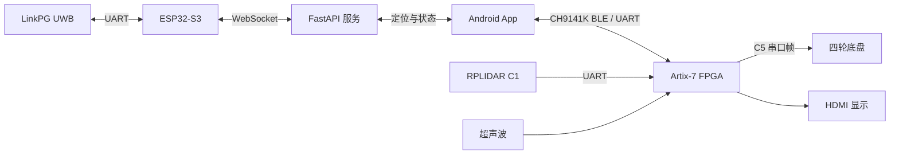

# Robei Car · FPGA 智能小车与 Android 控制系统

**集创赛全国二等奖作品** · 面向嵌入式软件、Linux 系统集成与机器人方向的项目展示。

[](https://github.com/Wbf200699-rgb/robei_car/actions/workflows/verify.yml)

基于 **Xilinx Artix-7 / RobeiEDA / Verilog** 的小车项目，配套 **Java/XML Android App**、**ESP32-S3 UWB 网关**和 **Python FastAPI 服务**。仓库按“硬件控制 → 通信 → 感知 → 可视化 → 验证”的链路组织，便于阅读源码、复现实验和面试讲解。

> 奖项信息由项目作者提供；个人具体分工未单独确认。本仓库保留工程来源及协作说明。功能以当前源码和归档证据为准，RTL 仿真、算法回放、历史实物记录分别标注。

## 从哪里开始

- **快速理解项目**：[系统架构](docs/ARCHITECTURE.md) · [功能与验证边界](docs/FEATURE_STATUS.md)
- **运行项目**：[环境与复现步骤](docs/GETTING_STARTED.md)
- **查看测试**：[本次整理验证记录](docs/VALIDATION.md) · [硬件参数与波形](docs/HARDWARE_PARAMETER_SIMULATION.md)
- **准备简历与面试**：[项目表达参考](docs/PORTFOLIO.md) · [演示与截图步骤](docs/DEMO_GUIDE.md)
- **了解来源**：[整理说明与代码来源](docs/PROVENANCE.md) · [第三方说明](THIRD_PARTY_NOTICES.md)

## 核心内容

| 模块 | 实现与可阅读的工程点 |
| --- | --- |
| FPGA 控制 | 路线状态机、C5 四轮速度到串口帧映射、手动命令看门狗、避障停车 |
| 感知与雷达 | RPLIDAR C1 UART 节点解析、八扇区距离、72 个角度栅格与六段带 CRC 数据传输；超声波测距 |
| 本地显示 | HDMI/TMDS 输出、路线与状态绘制、按键输入 |
| Android App | CH9141K BLE 连接、帧解析、路线/雷达/建图视图、参数调整、运动标定、UWB 状态展示 |
| 定位与网关 | ESP32-S3 接入 LinkPG UWB，FastAPI/WebSocket 转发，四标签刚体位姿估计与时效性检查 |
| 工程验证 | Robei 原生测试、紧凑 VCD 波形及 SHA-256 清单、Python/Java 测试与 CI |

主控制链使用 CH9141K BLE。UWB 网络链用于定位、展示与调试，不替代 BLE 紧急停止链。五路 VL53L1X 当前未启用，仅保留兼容实现和历史材料。



## 目录导航

```text
android/car_app/       Android Studio 项目、Java/XML 与单元测试
little_car/model/     Robei 开发模型（FPGA 设计源）
little_car/const/     管脚与工程约束
little_car/tb/        独立 RTL testbench
little_car/test/      Robei 测试、Verilog 镜像与波形证据
robei_model_project/  精简的原生 Robei 工程入口
esp32/uwb_gateway/    ESP32-S3 网关固件和配置模板
server/               FastAPI 服务、定位与协议测试
config/               几何配置的统一来源
tools/                转换、构建、标定分析和验证脚本
docs/                 架构、复现、验证、协议及历史实验记录
```

## 快速运行

RobeiEDA 打开 `robei_model_project/robei_model_project.proj`，选择一个 `_parameter.test` 运行，检查控制台 `RESULT TEST_PASS`。也可以通过 Icarus Verilog 批量运行：

```powershell
python tools/run_hardware_parameter_tests.py
```

Android Studio 打开 `android/car_app`，配置 Android SDK 36 和 JDK 17：

```powershell
cd android/car_app
.\gradlew.bat testDebugUnitTest :app:assembleDebug :app:lintDebug
```

服务器测试：

```powershell
python -m venv server/.venv
server/.venv/Scripts/python.exe -m pip install -r server/requirements-dev.txt
server/.venv/Scripts/python.exe -m pytest server/tests -q
```

全部环境细节、FPGA 源码生成和设备配置见 [GETTING_STARTED](docs/GETTING_STARTED.md)。

## 配置与复现说明

- Wi-Fi、Token、签名和本地 SDK 路径通过忽略的本地配置注入；仅提供示例文件。
- 展示版 UWB 默认地址使用 `relay.example.invalid` 占位符，需要自行填写服务地址；未配置时 BLE 仍是独立控制链。
- 实际运动参数由实车标定结果推算；`config/vehicle_geometry.json` 是几何参考配置，不是运动速度的测量结论。
- FPGA `build/` 目录、APK、工具附带仿真库、私有 Git 历史和旧工程备份不纳入本展示仓库。
- 本次 GitHub CI 已通过 Python/RTL 检查与 Android 测试、Debug APK 构建、Lint；未进行实车测试。完整执行结果见 [VALIDATION](docs/VALIDATION.md)。

## 适合展示的技术问题

1. 如何在 BLE 半帧、粘包和通知异步到达时保持状态解析完整？
2. 如何区分“通信已连接”和“传感器/状态数据仍然新鲜”？
3. 如何将 72 个雷达角度栅格分段传输并拒绝混帧、丢段和 CRC 错误？
4. 如何把 Robei 图形模型与可读 Verilog、独立 testbench 对照验证？
5. 如何为运动估计、四标签刚体拟合和地图算法划定实测与仿真的边界？

具体简历措辞请按实际负责模块选用 [PORTFOLIO](docs/PORTFOLIO.md)，避免把团队成果写成个人独立完成。

## 与嵌入式软件方向的关联

本项目可重点展示 **UART/BLE 协议、异步通信、状态机与看门狗、传感器数据处理、C/C++ 网关、Linux 网络服务和自动化验证**，并通过 FPGA 控制链说明软硬件联调基础。

面向机器人方向，可展开雷达角度栅格、占用地图、UWB 数据同步与位姿估计。当前没有 ROS 2、Linux 内核驱动或 AI 模型推理实现；这些方向的延伸计划见 [学习与扩展路线](docs/EMBEDDED_ROADMAP.md)。
