# little_car 详细系统架构图

下面这张图按当前 `sys_route_gui_fsm_top` 的真实连接绘制。实线表示控制或数据流，
虚线表示状态反馈、诊断或复位分发。连线标签使用源码里的关键变量名。

在 VS Code 中打开本文件后按 `Ctrl+Shift+V` 即可查看渲染图；预览窗口支持缩放。

```mermaid
flowchart LR
    %% ============================= Physical I/O =============================
    subgraph IO[物理接口与外设]
        direction TB
        CLK["50 MHz 时钟<br/>clk"]
        RESET["板级复位键<br/>rst_n"]
        KEYS["小车五向按键<br/>key_pin1..5"]
        PHONE["Android APP<br/>控制 / 参数 / 地图"]
        SERVER["公网/树莓派服务器<br/>定位融合 / 轨迹 / 命令状态"]
        ESP["ESP32-CAM 网关<br/>Wi-Fi + LinkPG UART"]
        ANCHORA["LinkPG 主基站 A<br/>四标签定位输出"]
        TAG1["车载 LinkPG 标签 1<br/>UWB + FPGA UART"]
        BLE["CH9141K<br/>BLE 透明串口 115200"]
        USDEV["前向超声波<br/>TRIG / ECHO"]
        LIDARDEV["RPLIDAR C1<br/>UART 460800"]
        C5DEV["C5 四轮控制总线<br/>ID 006 / 007 / 008 / 009"]
        SCREEN["1024x600 HDMI 屏幕"]
        BUZZERDEV["蜂鸣器"]
        PMWDEV["PMW3901 光流<br/>SPI"]
        BMI88["2 x BMI088<br/>ACC + GYRO SPI"]
        USBUART["板载 USB-UART<br/>@M 标定采集"]
    end

    PHONE <-->|"BLE GATT<br/>FFF2 写 / FFF1 通知"| BLE
    PHONE <-->|"HTTPS / WebSocket"| SERVER
    SERVER <-->|"网关 WebSocket"| ESP
    ESP <-->|"115200 UART"| ANCHORA
    ANCHORA <-->|"UWB 定位与数据透传"| TAG1

    %% ============================= Reset and input ==========================
    subgraph INPUT[复位、按键与输入统一层]
        direction TB
        POR["power_on_reset<br/>外部复位释放后再等待 20 ms"]
        RESETBUS(("system_rst_n<br/>内部低有效复位总线"))
        GPIOKEY["gpio_key_adapter<br/>适配实体按键极性"]
        UWBBRIDGE["linkpg_uwb_bridge<br/>Modbus CRC16 + 命令 CRC8<br/>重复抑制 / 空闲注入 / 状态分片"]
        BTRX["bt_route_uart 接收侧<br/>UART RX + 命令译码"]
        KEYMERGE["key_low_merge<br/>实体按键 AND 蓝牙模拟按键"]
        LOCK["route_key_lock_gate<br/>设置参数时阻断路线按键"]
    end

    CLK --> POR
    RESET --> POR
    POR --> RESETBUS
    KEYS -->|"key_pin*"| GPIOKEY
    BLE -->|"bt_uart_rx_in"| UWBBRIDGE
    TAG1 -->|"uwb_uart_rx"| UWBBRIDGE
    UWBBRIDGE -->|"bt_uart_rx_merged"| BTRX
    GPIOKEY -->|"gpio_key_*_n"| KEYMERGE
    BTRX -->|"bt_key_*_n<br/>自动路线模式下保持约 30 ms"| KEYMERGE
    KEYMERGE -->|"key_*_n"| LOCK

    %% ============================= Route and parameters =====================
    subgraph CONTROL[路线、参数与模式控制]
        direction TB
        KEYFILTER["sys_route_control_fsm<br/>5 x key_pulse_filter 消抖"]
        ROUTECORE["route_contol_core<br/>菜单 / 编辑 / 运行 / 障碍停止 FSM"]
        ROUTEMEM["路线与位置状态<br/>route_info[63:0]：每命令 2 bit<br/>00停 01右 10左 11前<br/>now/target x,y + completed/active"]
        PARAM["car_param_controller<br/>整体速度、步长、四轮校准、雷达距离"]
        PARAMMEM["参数寄存器<br/>speed 100..900 / 25<br/>step 5..80 / 5<br/>lidar 150..1500 mm / 50"]
    end

    LOCK --> KEYFILTER
    KEYFILTER -->|"key_*_pulse"| ROUTECORE
    ROUTECORE <--> ROUTEMEM
    BTRX -->|"cfg mode/select/inc/dec pulse"| PARAM
    PARAM <--> PARAMMEM
    PARAM -->|"route_key_lock"| LOCK

    %% ============================= Sensors ==================================
    subgraph SENSE[双源环境感知与避障]
        direction TB
        ULTRA["ultrasonic_obstacle_guard<br/>10 us TRIG / 30 ms timeout / 60 ms period"]
        ULTRARES["超声结果<br/>distance_cm / valid / timeout<br/>ultrasonic_obstacle_stop"]
        LIDAR["rplidar_c1_uart<br/>A5 25 -> wait -> A5 20<br/>5 字节扫描节点解析"]
        FILTER["雷达数据处理<br/>Q6 角度 + Q2 距离<br/>8 x 45° 扇区最小值<br/>连续三圈中值滤波"]
        FOOTPRINT["长方形轮廓避障<br/>正前：safe_distance<br/>前角：safe + 150 mm<br/>侧面：约 220 mm"]
        OBSMERGE["obstacle_stop_merge<br/>ultrasonic OR lidar"]
        OBS(("obstacle_stop<br/>最终停车请求"))
    end

    USDEV -->|"ultrasonic_echo"| ULTRA
    ULTRA -->|"ultrasonic_trig"| USDEV
    ULTRA --> ULTRARES
    LIDARDEV -->|"lidar_uart_rx"| LIDAR
    LIDAR -->|"lidar_uart_tx"| LIDARDEV
    BTRX -->|"lidar_enable E/Q"| LIDAR
    PARAMMEM -->|"lidar_safe_mm"| FOOTPRINT
    LIDAR --> FILTER --> FOOTPRINT
    ULTRARES -->|"ultrasonic_stop"| OBSMERGE
    FOOTPRINT -->|"lidar_stop"| OBSMERGE
    OBSMERGE --> OBS

    %% ============================= Motion ===================================
    subgraph MOTION[运动决策、轮速映射与 C5 串口]
        direction TB
        PRIORITY["c5_route_controller 控制优先级<br/>1. motor_enable=0<br/>2. manual_mode<br/>3. obstacle_stop<br/>4. 自动路线"]
        MANUAL["手动动作<br/>0停 1前 2后 3左转 4右转<br/>300 ms 看门狗"]
        SPEEDCALC["四轮校准算法<br/>wheel = clamp(common + default - 700)<br/>转向幅值再减 50"]
        SIGNED["11 bit 二补码轮速<br/>lf/rf/lr/rr_speed"]
        C5FRAME["c5_motor_frame_driver<br/>左轮 1500 + speed<br/>右轮 1500 - speed"]
        PROTECT["C5 保护调度<br/>上电等待 500 ms<br/>连续 3 x #255PDST!<br/>运动每 100 ms 刷新"]
        C5DIAG["C5 诊断<br/>frame_count / frame_busy<br/>last four pulses<br/>stop_frames_remaining"]
    end

    BTRX --> MANUAL --> PRIORITY
    ROUTEMEM -->|"route_info[1:0], state_info"| PRIORITY
    PARAMMEM -->|"overall + LF/RF/LR/RR defaults<br/>step_length"| SPEEDCALC
    OBS --> PRIORITY
    PRIORITY --> SPEEDCALC --> SIGNED --> C5FRAME --> PROTECT
    PROTECT -->|"c5_uart_tx 115200"| C5DEV
    PROTECT --> C5DIAG
    PRIORITY -->|"run_step_pulse"| ROUTECORE
    PRIORITY -.->|"motor_blocked"| C5DIAG

    %% ============================= Bluetooth reports ========================
    subgraph REPORT[蓝牙闭环与手机数据协议]
        direction TB
        BTTX["bt_route_uart 唯一 TX 调度器<br/>一帧发送完成后才允许下一帧"]
        ACK["短回复队列<br/>@Kx\n / @PONG\n"]
        STATUS["@S 路线/参数/C5 状态<br/>变化立即发 + 200 ms 周期 + ? 强制查询<br/>尾部 8 bit 序号"]
        LREPORT["@L 双传感器/八扇区状态<br/>FFFF 代表无效距离<br/>尾部 8 bit 序号"]
        HEART["心跳与在线判定<br/>P 每约 1 s<br/>3 s 未收到则 BT OFF"]
    end

    BTRX --> HEART
    BTRX --> ACK
    ROUTEMEM -.-> STATUS
    PARAMMEM -.-> STATUS
    MANUAL -.-> STATUS
    C5DIAG -.-> STATUS
    ULTRARES -.-> LREPORT
    FILTER -.-> LREPORT
    FOOTPRINT -.-> LREPORT
    OBS -.-> LREPORT
    ACK --> BTTX
    STATUS --> BTTX
    LREPORT --> BTTX
    HEART --> BTTX
    BTTX -->|"bt_uart_tx"| BLE
    BTTX -.->|"bt_uart_tx_tap"| UWBBRIDGE
    UWBBRIDGE -->|"uwb_uart_tx<br/>ACK + 分片状态"| TAG1

    %% ============================= Motion calibration ======================
    subgraph CALIB[独立运动传感器标定固件：当前不接主车/C5]
        direction TB
        MOTIONTOP["motion_sensor_bringup_top<br/>独立上电复位与 LED"]
        MOTIONSPI["motion_sensor_subsystem<br/>共享 SPI mode 3 + 五路片选"]
        IMUFUSION["512 样本陀螺零偏<br/>双 IMU 一致性 / 单块降级"]
        FLOWCAL["PMW3901 DX/DY/SQUAL<br/>轴向与每毫米计数待标定"]
        MFRAME["99 字节 @M / 100 ms<br/>一致快照 + 16 bit 序号"]
    end

    CLK -.-> MOTIONTOP
    RESET -.-> MOTIONTOP
    PMWDEV --> MOTIONSPI
    BMI88 --> MOTIONSPI
    MOTIONTOP --> MOTIONSPI
    MOTIONSPI --> IMUFUSION
    MOTIONSPI --> FLOWCAL
    IMUFUSION --> MFRAME
    FLOWCAL --> MFRAME
    MFRAME --> USBUART

    %% ============================= HDMI =====================================
    subgraph VIDEO[HDMI 状态显示流水线]
        direction TB
        RENDER["gui_route_renderer<br/>无帧缓存逐像素组合绘制<br/>状态栏 + 路线 + 当前位置 + 目标"]
        RGB["rgb_data[23:0]<br/>RGB888"]
        MMCM["clk_wiz_0<br/>MMCME2_ADV + BUFG<br/>50 MHz pixel / 250 MHz serial"]
        TIMING["hdmi_timing_gen<br/>1024x600<br/>总时序 1324x645"]
        TMDS["3 x hdmi_tmds_encoder<br/>RGB 8 bit -> TMDS 10 bit"]
        SER["4 x hdmi_serializer<br/>ODDR + OBUFDS<br/>D0/D1/D2/CLK 差分"]
    end

    ROUTEMEM -.-> RENDER
    HEART -.->|"bt_connected"| RENDER
    LIDAR -.->|"lidar_online"| RENDER
    RENDER --> RGB --> TMDS
    CLK --> MMCM
    RESETBUS -.-> MMCM
    MMCM -->|"pixel_clk"| TIMING
    TIMING -->|"pixel_x/y, pixel_de, hsync/vsync"| RENDER
    TIMING --> TMDS
    MMCM -->|"clk_5x"| SER
    TMDS --> SER --> SCREEN

    %% ============================= Buzzer ===================================
    subgraph SOUND[蜂鸣反馈]
        direction TB
        EVENTS["buzzer_event_gen<br/>上电/加路线/进入运行/停止边沿"]
        BUZZ["buzzer_ctrl<br/>事件优先级 + 节奏 + 方波分频"]
    end

    RESETBUS -.-> EVENTS
    ROUTEMEM -.-> EVENTS
    PRIORITY -.-> EVENTS
    EVENTS --> BUZZ --> BUZZERDEV

    %% Reset distribution is shown once to avoid crossing every block.
    RESETBUS -.-> KEYFILTER
    RESETBUS -.-> ROUTECORE
    RESETBUS -.-> PARAM
    RESETBUS -.-> ULTRA
    RESETBUS -.-> LIDAR
    RESETBUS -.-> PRIORITY
    RESETBUS -.-> PROTECT
    RESETBUS -.-> BTRX

    classDef physical fill:#f5f5f5,stroke:#555,color:#111;
    classDef input fill:#dff1ff,stroke:#2878a5,color:#111;
    classDef control fill:#fff1c7,stroke:#a87900,color:#111;
    classDef sensor fill:#dcf5df,stroke:#287a37,color:#111;
    classDef motion fill:#ffe1dd,stroke:#ae4034,color:#111;
    classDef report fill:#ece4ff,stroke:#6946a5,color:#111;
    classDef video fill:#dff4f0,stroke:#27766a,color:#111;
    classDef sound fill:#fff0d9,stroke:#9a621c,color:#111;
    classDef calib fill:#eef7df,stroke:#607d2b,color:#111;

    class CLK,RESET,KEYS,PHONE,SERVER,ESP,ANCHORA,TAG1,BLE,USDEV,LIDARDEV,C5DEV,SCREEN,BUZZERDEV,PMWDEV,BMI88,USBUART physical;
    class POR,RESETBUS,GPIOKEY,UWBBRIDGE,BTRX,KEYMERGE,LOCK input;
    class KEYFILTER,ROUTECORE,ROUTEMEM,PARAM,PARAMMEM control;
    class ULTRA,ULTRARES,LIDAR,FILTER,FOOTPRINT,OBSMERGE,OBS sensor;
    class PRIORITY,MANUAL,SPEEDCALC,SIGNED,C5FRAME,PROTECT,C5DIAG motion;
    class BTTX,ACK,STATUS,LREPORT,HEART report;
    class RENDER,RGB,MMCM,TIMING,TMDS,SER video;
    class EVENTS,BUZZ sound;
    class MOTIONTOP,MOTIONSPI,IMUFUSION,FLOWCAL,MFRAME calib;
```

## 从图到源码

| 图中区域 | 第一入口文件 | 应重点观察的变量 |
|---|---|---|
| 路线控制 | `verilog/route_contol_core.v` | `state_info`、`route_info`、`active_route_steps`、`now_x/y` |
| 参数 | `verilog/car_param_controller.v` | `selected_param`、`overall_speed`、四轮默认值、`lidar_safe_mm` |
| 运动决策 | `verilog/c5_route_controller.v` | `manual_mode`、`manual_cmd`、`obstacle_stop`、四轮 `speed` |
| C5 总线 | `verilog/c5_motor_frame_driver.v` | `frame_is_stop`、`stop_frames_remaining`、`frame_char` |
| 蓝牙 | `verilog/bt_route_uart.v` | `rx_data`、`pending_reply`、`sending_status`、`status_char` |
| UWB 桥 | `verilog/linkpg_uwb_bridge.v` | `uwb_frame_index`、`command_pending`、`report_buffer`、`stream_state` |
| 运动传感器标定 | `verilog/motion_sensor_subsystem.v` | `main_state`、`spi_state`、`calibration_count`、`flow_squal`、`imu_source` |
| 雷达 | `verilog/rplidar_c1_uart.v` | `cmd_state`、`node_*`、`sector_min_*`、`median3_q2` |
| 超声波 | `verilog/ultrasonic_obstacle_guard.v` | `state`、`echo_cycles`、`distance_cm` |
| HDMI | `verilog/hdmi_top.v` | `pixel_clk`、`pixel_de`、三路 `tmds_10b` |
